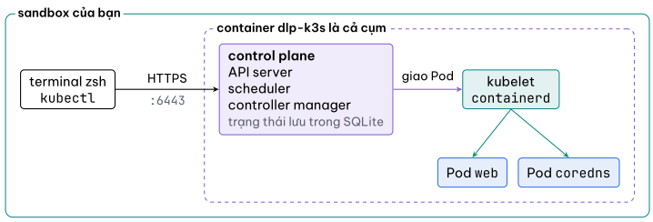

# Cụm của bạn nằm ở đâu

Hỏi cụm xem nó là ai:

`kubectl cluster-info`{{exec}}

Dòng đầu là địa chỉ của **API server**. Đây là thứ duy nhất `kubectl` nói chuyện
cùng: mọi lệnh bạn gõ trong bài, từ xem tới xoá, đều là một request HTTPS tới
`https://127.0.0.1:6443`. Không có đường tắt nào vào node.

`kubectl get nodes -o wide`{{exec}}

Một node, cột `STATUS` là `Ready`, cột `INTERNAL-IP` dạng `172.17.0.x`. Địa chỉ đó
không phải của một máy ảo. Nó thuộc một container Docker chạy ngay trong sandbox:

`docker ps`{{exec}}

Container `dlp-k3s` chạy image `rancher/k3s`. Toàn bộ "cụm" là một tiến trình
`k3s server` trong container ấy, gói chung API server, scheduler, controller
manager, kubelet và containerd. Cụm sản xuất tách những thứ này ra nhiều máy; k3s
gộp lại cho nhẹ, còn cách bạn dùng `kubectl` thì giống hệt.

Cụm mới dựng đã có sẵn vài Pod hệ thống:

`kubectl get pods -A`{{exec}}

`-A` nghĩa là mọi namespace. Bạn sẽ thấy `coredns` (DNS nội bộ của cụm) và
`local-path-provisioner` (cấp ổ đĩa cho Pod), cả hai nằm ở namespace
`kube-system`. Đừng xoá chúng; bước 6 nói kỹ hơn về namespace.

Bước này chỉ để nhìn, không có gì để kiểm. Sang bước 2.
