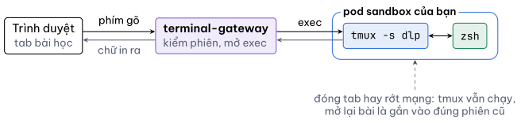

Bấm vào một khối lệnh thì lệnh được gõ vào terminal và chạy luôn. Bắt đầu bằng ba câu hỏi:

`whoami`{{exec}}

`hostname`{{exec}}

`cat /etc/os-release`{{exec}}

`whoami` trả lời `root`. Trên máy này bạn là quản trị viên, nên mọi lệnh trong bài chạy thẳng, không cần `sudo`. `hostname` in một cái tên kiểu `sandbox-48ceb974b668`: đó là tên pod Kubernetes đang chứa máy của bạn, mỗi phiên một tên khác. Trong `/etc/os-release`, dòng `PRETTY_NAME` cho biết đây là Ubuntu 24.04.

Câu thứ tư: đang đứng ở thư mục nào, và ở đó có gì.

`pwd`{{exec}}

`ls -a`{{exec}}

`pwd` in `/root`, thư mục nhà của root. `ls -a` hiện cả những tệp tên bắt đầu bằng dấu chấm như `.zshrc`. Đó là tệp ẩn, `ls` trần không hiện chúng. Thư mục `kho` là thứ bài này dựng sẵn cho bạn.

Phím bạn gõ đi một quãng khá dài mới tới shell:

Vì phiên tmux sống trong pod nên mạng chập chờn hay lỡ tay đóng tab đều không giết lệnh đang chạy: mở lại bài, bạn thấy đúng màn hình cũ. Thứ duy nhất xoá sạch mọi thứ là hết giờ phiên.
